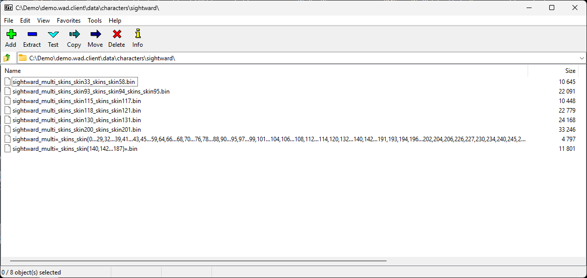
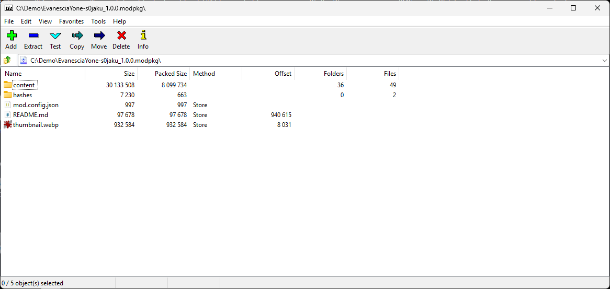

# lol7z

A 7-Zip plugin for League of Legends files. One DLL, `lol7z.dll`, adds two formats to
7-Zip's file manager and command line:

- **WAD** (`*.wad`, `*.wad.client`): the game's archives, read in every version from 1
  to 3.4 and written as 3.4. Entries get their real paths from the Mimir hash tables.
- **modpkg** (`*.modpkg`): the LeagueToolkit mod package. A package lists as the mod
  project it was packed from, and a mod project packs back into a package.

## Why

**WADs** have been served by many tools over the years, and most of them are abandoned
now. The ones that remain handle the archive's long names poorly: a path hash the
tables don't know, or a name longer than Windows allows, gets mangled, truncated or
silently dropped, and what you extracted can't be put back. This plugin shows every
entry under a name that reads back to the same hash, folds a too-long name into a
notation that expands again, and refuses rather than guesses. The rules are in
[docs/names.md](docs/names.md).

**modpkg** is a binary container with a MessagePack document inside, which makes it an
opaque blob when you are writing a tool against it or debugging one: nothing on the
machine will show you what is in it. Opening it in 7-Zip makes it a folder tree again:
`mod.config.json`, `README.md`, `hashes/`, `content/<layer>/...`, exactly the project
layout the reference importer writes, with the document shown as the config it came
from. The layout and the pack rules are in [docs/modpkg.md](docs/modpkg.md).

## Install

7-Zip loads plugins from one place only: a `Formats` folder next to its own `7z.dll`,
under Program Files. It does not look in your profile, so installing needs elevation
once. The release page has an MSI that finds 7-Zip through the registry and puts the
DLL there; it shows up in Apps & features and uninstalls from there. Install 7-Zip
(64-bit) first.

Or by hand: build and copy.

```bash
cargo build --release -p lol7z
```

```
C:\Program Files\7-Zip\Formats\lol7z.dll
```

Restart 7-Zip afterwards; `7z i` then lists `WAD` and `modpkg` among the formats.

## Use

Anything 7-Zip does with an archive. The switches that matter:

```bash
7z l Aatrox.wad.client
7z x -o out my-mod_1.0.0.modpkg
7z a -tmodpkg my-mod_1.0.0.modpkg ./my-mod/*
7z a -twad -mx=9 Aatrox.wad.client ./assets/*
```

`-mx=N` picks the zstd level for both formats, 0 stores. Packing a modpkg needs a
`mod.config.json` in the tree.

## What it looks like

```
> 7z i
Formats:
 1 C....M.................  WAD      wad client    R W 01  ||  R W 02  ||  R W 03
 1 C......................  modpkg   modpkg        _ m o d p k g _
```

A WAD lists by the paths the game hashed. A name longer than Windows allows is folded
into a block that expands again on the way back:

```
> 7z l demo.wad.client data\characters\sightward\*
Type = WAD
Version = 3.4
Comment = names: game-2026-10-12, lcu-2026-10-12

   Date      Time    Attr         Size   Compressed  Name
------------------- ----- ------------ ------------  ------------------------
                    .....        10645         1951  data\characters\sightward\sightward_multi_skins_skin33_skins_skin58.bin
                    .....        22091         2413  data\characters\sightward\sightward_multi_skins_skin93_skins_skin94_skins_skin95.bin
                    .....        11801         2203  data\characters\sightward\sightward_multi«_skins_skin{140,142…187}».bin
                    .....         4797         1408  data\characters\sightward\sightward_multi«_skins_skin{0…29,32…39,41…43,45…59,64,66…68,70…76,78…88,90…95,97…99,101…104,106…108,112…114,120,132…140,142…191,193,194,196…202,204,206,226,227,230,234,240,245,247,248,250,259,266}».bin
```



A modpkg lists as the mod project it was packed from, its metadata document shown as
`mod.config.json`:

```
> 7z l EvanesciaYone-s0jaku_1.0.0.modpkg -x!content\*\yone.wad.client\*
Type = modpkg
Version = 1
Comment = Evanescia Yone 1.0.0 by s0jaku; layers: base (0), voice (1), hud (2)

   Date      Time    Attr         Size   Compressed  Name
------------------- ----- ------------ ------------  ------------------------
                    .....       932584       932584  thumbnail.webp
                    .....        97678        97678  README.md
                    .....            0            0  hashes\game.hashes.txt
                    .....         7230          663  hashes\binentries.hashes.txt
                    .....         2091         1495  content\base\overrides\yone-skin0.ptch
                    .....         1094          271  content\hud\overrides\yone-hud.ptch
                    .....         4907         1242  content\voice\overrides\yone-skin0-voice.ptch
                    .....          997          997  mod.config.json
                    .....          410          410  content\base\game_data.json
                    .....          234          234  content\voice\game_data.json
                    .....          219          219  content\hud\game_data.json
                    D....                            content\base
                    D....                            content\voice
                    D....                            content\hud
------------------- ----- ------------ ------------  ------------------------
                               1047444      1035793  11 files, 3 folders
```



## Layout

| Crate | What it is |
|---|---|
| `crates/lol7z-sys` | Bindings to 7-Zip's COM interfaces, generated from its headers |
| `crates/lol7z-api` | A safe API for writing a 7-Zip format on top of the bindings |
| `crates/lol7z-fold` | The notation that folds an over-long file name and expands it again |
| `crates/lol7z-wad` | The WAD format |
| `crates/lol7z-modpkg` | The modpkg format |
| `crates/lol7z` | The DLL: the formats above, exported |

License: MIT.

## 🤖 Robots inside

Much of this code was written with Claude. I reviewed the `lol7z-sys` bindings, which
hold the `unsafe` that talks to 7-Zip, and did a lighter review of `lol7z-api`, which
also holds `unsafe` and builds on them. The format crates are covered by tests against
real archives, the format specification and 7-Zip itself.
